# pyCertWiz

[](https://github.com/rob-c/pyCertWiz/actions/workflows/ci.yml)


**A certificate manager for the UK e-Science CA, and for ACME CAs, written in
Python.**

pyCertWiz replaces the Java **CertWizard** client and turns it into a manager for
*many* user and host certificates. It requests certificates, waits for RA
approval and CA signing, verifies the full chain, renews, deploys keys and
certificates to services, and watches expiry. It can also use CertWizard's own
`cakeystore.pkcs12` directly as its store. It runs as a desktop application,
from the command line, or unattended from cron or systemd.

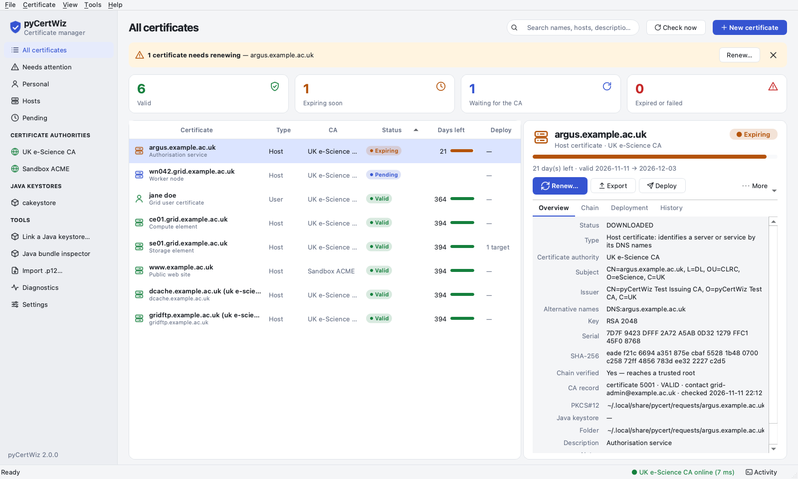

<sub>Screenshots are generated by `make screenshots` against the bundled sandbox
CA, so the issuer is "pyCertWiz Test Issuing CA" and the names are examples.</sub>

---

## Contents

- [Highlights](#highlights)
- [Install](#install)
- [Quick start](#quick-start)
- [A tour of the desktop application](#a-tour-of-the-desktop-application)
- [The command line](#the-command-line)
- [How pyCertWiz keeps keys safe](#how-pycertwiz-keeps-keys-safe)
- [Moving from CertWizard](#moving-from-certwizard)
- [Configuration](#configuration)
- [What pyCertWiz writes](#what-pycertwiz-writes)
- [How it works](#how-it-works)
- [The legacy CA listener, sandbox CA and ACME wrapper](#the-legacy-ca-listener-sandbox-ca-and-acme-wrapper)
- [Development and tests](#development-and-tests)
- [Compatibility, limitations and licence](#compatibility-notes)
- [Documentation index](#documentation-index)

---

## Highlights

**Requesting and renewing**
- Generates every key and CSR locally. Private keys never leave the machine.
- Speaks the UK e-Science CA's CertWizard protocol (XML over HTTPS, PPPK
  authentication, RA PINs) and **ACME** (RFC 8555, with External Account
  Binding) for Let's Encrypt, Sectigo/Jisc or a future UK-CA ACME service.
- Requests many host certificates at once; each host gets its own key, CSR,
  PIN and certificate.
- Renews with a new key, authenticated by the current certificate. Before a
  UK-CA renewal pyCertWiz checks the CA's record of the certificate, as
  CertWizard does, and keeps the contact e-mail the CA holds. A working
  certificate is never replaced until its successor is issued and verified.

**Looking after many certificates**
- Desktop app with views for everything, what needs attention, user and host
  certificates, each CA and each linked keystore; summary cards; search;
  background collection of issued certificates; menu-bar/tray notifications.
- Every certificate shows whether it is a **User** or a **Host** certificate.
- Rename certificates so the list makes sense to you, optionally renaming the
  Java keystore entry too.
- `pycert check` is a Nagios/Icinga plugin; `pycert report` exports CSV or
  JSON; `pycert watch` collects and deploys unattended.

**Keys, exports and keystores**
- **Java keystores as a live store**: link CertWizard's `cakeystore.pkcs12`,
  and its entries are managed in place. Untouched entries stay byte-for-byte
  identical, and the keystore passphrase is never stored.
- **Exports in the format you need**: PKCS#12 (AES-256, or 3DES for old Java
  and Windows), PEM bundle or files, the key alone, the certificate, the full
  chain, DER or PKCS#7. Anything with a key needs a **new** passphrase.
- A viewer for the full chain, the public key and, on request, the private key.
- **Deployment** to `/etc/grid-security`, nginx, Apache or custom paths, with
  reload hooks, redone after every renewal, and drift detection.

**Built to be trusted**
- Pinned CA trust anchors, full chain verification, modern PKCS#12,
  atomic writes with explicit permissions, no unprotected private keys.
- Needs only [`cryptography`](https://cryptography.io/) at runtime, on
  Python 3.10+. The GUI (PySide6) and `keyring` are optional extras.
- 7,000+ tests with **100% line and branch coverage**, GUI included. They run
  against a mock CA over real TLS, the sandbox ACME server and, optionally, the
  real Java CertWizard.

---

## Install

Ready-made packages are on the [releases page](https://github.com/rob-c/pyCertWiz/releases).
They carry their own Python and Qt, so nothing else needs installing first.

| System | Download | Install |
|---|---|---|
| macOS 12+, Apple silicon or Intel | `pyCertWiz-<version>-macos-arm64.dmg`, `…-x86_64.dmg` | open it and drag pyCertWiz to Applications |
| Debian 10+, Ubuntu 20.04+ | `pycertwiz_<version>-1_amd64.deb`, `…_arm64.deb` | `sudo apt install ./pycertwiz_*.deb` |
| Fedora, RHEL/AlmaLinux/Rocky 8+, openSUSE | `pycertwiz-<version>-1.x86_64.rpm`, `….aarch64.rpm` | `sudo dnf install ./pycertwiz-*.rpm` (or `zypper install`) |
| Arch Linux | `pycertwiz-<version>-1-x86_64.pkg.tar.zst` | `sudo pacman -U pycertwiz-*.pkg.tar.zst` |
| any other Linux | `pyCertWiz-<version>-x86_64.AppImage`, `…-aarch64.AppImage` | `chmod +x` it and run it |
| Nix | | `nix run github:rob-c/pyCertWiz` |
| Python 3.10+ | | `pip install 'pyCertWiz[gui]'` |

The packages add `pycertwiz` and `pycert` commands and a pyCertWiz entry in
the applications menu. The first time it opens, the desktop application asks
a few questions and sets itself up (see [Quick start](#quick-start)). The
AppImage is the command line when given arguments:
`./pyCertWiz-2.0.0-x86_64.AppImage renew --due 30`.

The x86_64 Linux packages run on glibc 2.28 and newer (RHEL 8, Debian 10,
Ubuntu 20.04 onwards). The aarch64 packages need glibc 2.39 (Ubuntu 24.04,
Debian 13, RHEL 10), as Qt's own aarch64 builds do. Every package is tested
end to end on these distributions before a release; see
[docs/PACKAGING.md](docs/PACKAGING.md).

With pip, the latest development version:

```console
$ python3 -m venv ~/.venvs/pycert
$ ~/.venvs/pycert/bin/pip install 'pyCertWiz[gui] @ git+https://github.com/rob-c/pyCertWiz'
$ ~/.venvs/pycert/bin/pycert --version
```

From a checkout:

```console
$ git clone https://github.com/rob-c/pyCertWiz ~/src/pyCertWiz
$ cd ~/src/pyCertWiz
$ python3 -m venv .venv
$ .venv/bin/pip install -e '.[gui]'        # drop [gui] on servers
```

| Extra | Adds |
|---|---|
| `gui` | the PySide6 desktop application |
| `keyring` | the OS keyring secret backend through the `keyring` library |
| `all` | both |
| `dev` | tests and tooling (pytest, pytest-qt, pytest-xdist, ruff, build) |

---

## Quick start

```console
$ pycert init ~/.config/pycert --email you@example.ac.uk --ra "CLRC DL"
$ pycert config check
OK: 4 CA certificates loaded, 4 trust anchors, all pins verified.
Data directory ~/.local/share/pycert is 0o700
$ pycert gui                                  # or carry on in the terminal
$ pycert request "Jane Doe" --wait            # a user certificate
$ pycert request host.example.ac.uk --type host --auth "jane doe" --wait
```

The desktop application asks for the same things (e-mail address, RA and where
to keep the saved secret) the first time it opens, and writes the same files.

`pycert init` copies the bundled UK e-Science CA certificates into the
configuration directory and records their SHA-256 fingerprints. They are the
TLS trust anchors for the CA server, the anchors for chain validation, and the
chain written into exports. It also creates the **saved secret**, which
protects pyCertWiz's own copy of every key, in the macOS Keychain or Freedesktop
Secret Service.

Host certificates from the UK e-Science CA are authenticated with a valid RSA
user certificate (`--auth`). Already have certificates in CertWizard? Link its
keystore and they all appear at once (see
[Java keystores](#java-keystores-as-a-live-store)).

---

## A tour of the desktop application

```console
$ pycert gui
```

### The main window


- **Sidebar**: views for all certificates, those needing attention, user
  (*Personal*) and host certificates and pending requests; one entry per CA,
  with a dot showing whether it is reachable; and each linked **Java
  keystore**.
- **Banner and cards**: what needs doing ("1 certificate needs renewing"),
  with a one-click *Renew…*.
- **Table**: name and description, **Type** (User or Host), CA, a status pill
  (always with a text label), days left and deployment targets. Sort, search,
  and right-click the header to choose columns.
- **Details**: the next sensible action (*Renew…*, *Export*, *Deploy*), and
  *Overview*, *Chain*, *Deployment* and *History* tabs. The *CA record* line
  shows what the CA holds: certificate id, status and contact e-mail.
- **Background monitoring**: pending requests are polled, and issued
  certificates are collected, exported and deployed, with a notification.

### Requesting certificates

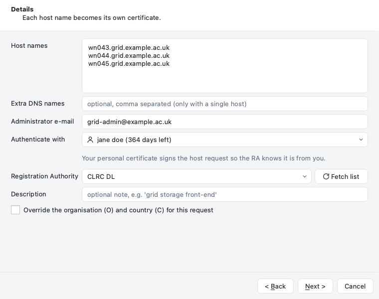

**New certificate** opens a wizard that adapts to the CA: the RA and PIN for
the UK e-Science CA, and domain validation for ACME. Each host name you list
becomes its own certificate. The wizard can set up deployment for each one, and
can store the issued certificate in a linked Java keystore. PINs are shown once
and never logged.

### Certificate, keys and chain

**More → View certificate, keys and chain…** (Ctrl/Cmd+K):

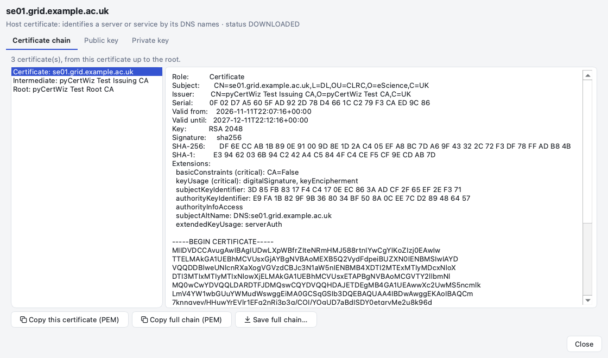

<p>
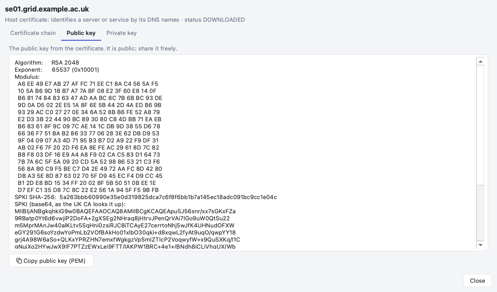
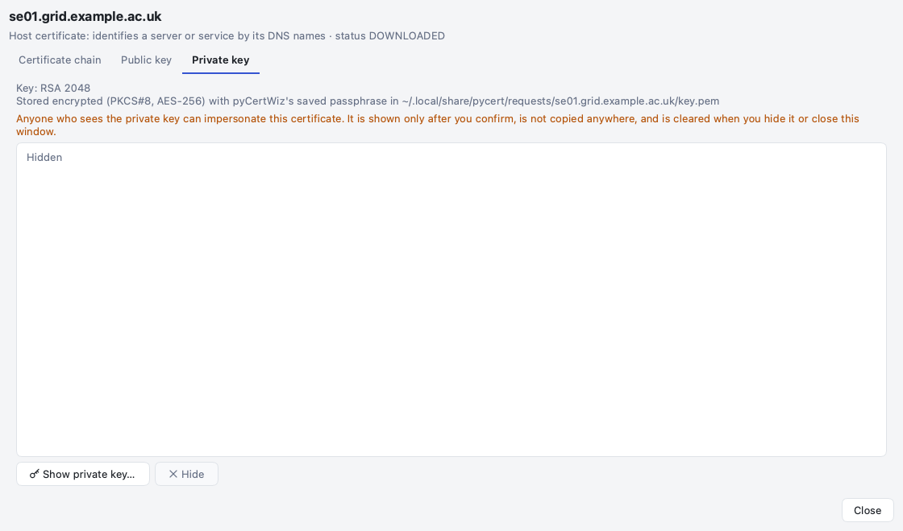
</p>

- **Certificate chain**: every certificate from yours up to the root, with
  details, extensions, fingerprints and PEM. Copy one certificate or the full
  chain, or save the full chain.
- **Public key**: algorithm, modulus or curve point, the SPKI fingerprint and
  the base64 form the UK CA uses to look certificates up.
- **Private key**: where and how it is stored. *Show private key…* decrypts
  it only after you type `show`. It cannot be copied from the viewer and is
  cleared when you hide it or close the window.

### Exporting

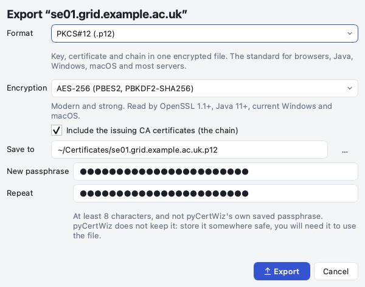

**Export…** (Ctrl/Cmd+E) chooses the format, the encryption and whether to
include the chain. Anything containing a private key needs a **new
passphrase**, typed twice: at least 8 characters, and not pyCertWiz's saved
secret, so an exported file never shares a secret with pyCertWiz's store. pyCertWiz
does not keep it.

| Format | Contains | Encryption |
|---|---|---|
| **PKCS#12** (`.p12`, default) | key, certificate, chain | AES-256 (PBES2/PBKDF2-SHA256) or 3DES for Java 8 and older Windows |
| PEM bundle | encrypted key, certificate, chain | PKCS#8 AES-256, or traditional OpenSSL |
| Separate PEM files | `<name>.pem` and `<name>.key` | as above, or no passphrase after you type `unencrypted` |
| Private key only | the key | as above, or no passphrase after you type `unencrypted` |
| Certificate, full chain, DER, PKCS#7 | public data only | none needed |

Bundles are always encrypted. See [docs/EXPORTING.md](docs/EXPORTING.md).

### Renewing

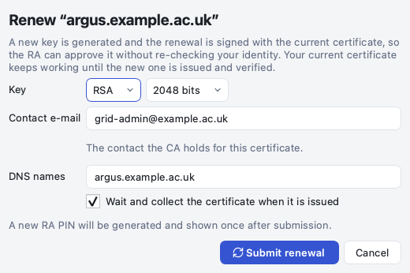

**Renew…** first asks the CA for its record of the certificate. If the CA does
not report it as VALID (revoked, unknown, or expired more than 30 days ago),
pyCertWiz says why and stops. Otherwise the dialog fills in the contact e-mail
the CA holds, and warns you if you change it. The renewal is signed with the
current certificate (PPPK), a new RA PIN is shown once, and the current
certificate keeps working until the new one is issued and verified.
**Certificate → Renew everything due…** renews them all.

### Renaming

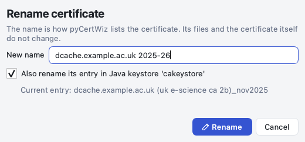

**More → Rename…** (F2) gives a certificate a clearer name. For a certificate
in a linked Java keystore it can rename the keystore entry too, so CertWizard
shows the same name. Only that entry is rewritten.

### Java keystores as a live store

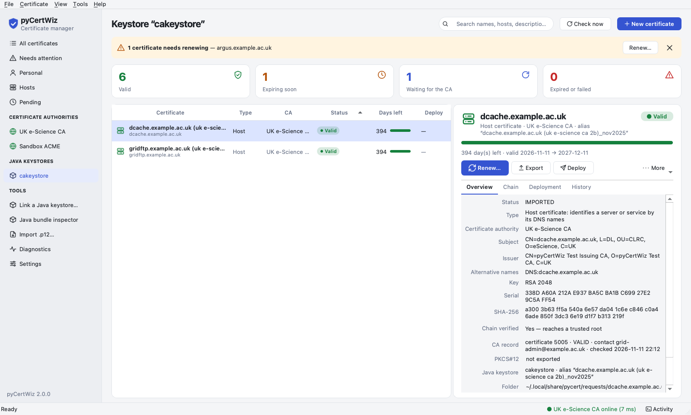

**Link a Java keystore…** uses CertWizard's `cakeystore.pkcs12`, or any
PKCS#12 keystore, as a store. Its entries appear under **Java keystores**.
Entries added by Java tools are picked up, and certificates pyCertWiz issues or
renews are written back. CertWizard's pending requests are finished by pyCertWiz.
The passphrase is **never stored**: pyCertWiz asks for it at start-up, and
*Cancel* leaves the keystore locked (padlock icon). See
[docs/KEYSTORES.md](docs/KEYSTORES.md).

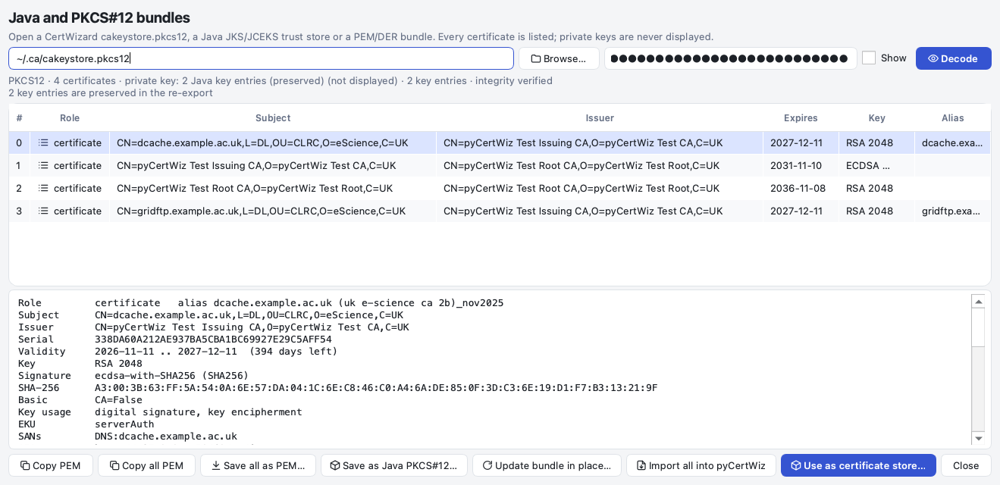

The **Java bundle inspector** opens CertWizard keystores, JKS/JCEKS trust
stores and PEM/DER bundles. It lists every certificate with its role, verifies
the integrity MAC, and can save all certificates as PEM, write a
Java-compatible PKCS#12 (with a new passphrase), import every key entry, or
start using the keystore as a store.

### Deployment

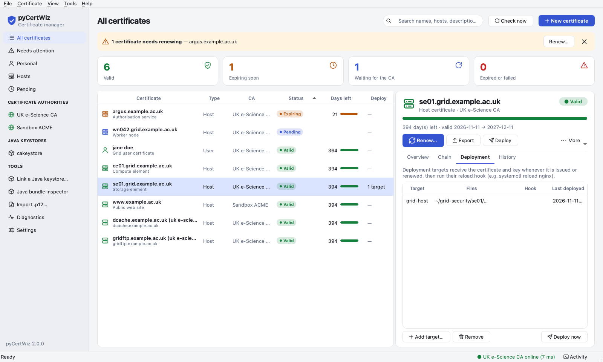

The *Deployment* tab lists where a certificate is installed: presets for
`/etc/grid-security`, nginx and Apache, or custom paths, each with an optional
reload hook. Targets are redeployed after every renewal, and `pycert check`
reports drift.

### Settings and several CAs

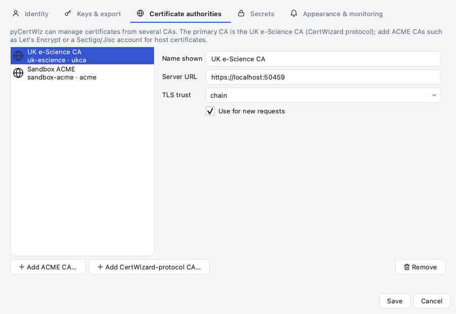

**Tools → Settings** edits identity defaults, key types and export naming, the
CA profiles (add ACME CAs with EAB, or other CertWizard-protocol CAs), the
secret backend, appearance, warning thresholds and background checks.

### Dark mode

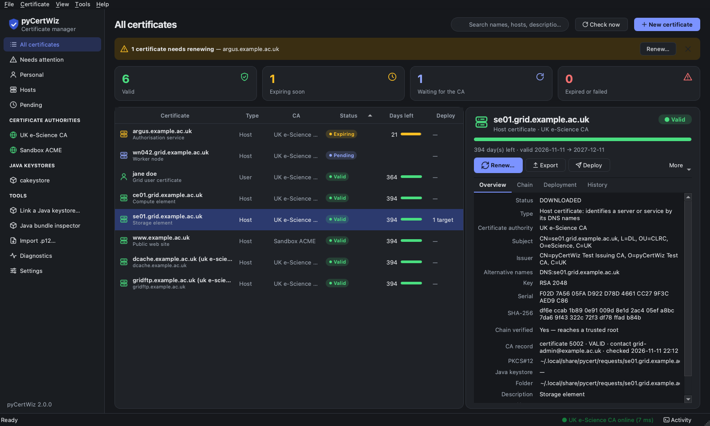

The application follows the system appearance live, or **View → Appearance**
overrides it.

### Keyboard

| Shortcut | Action |
|---|---|
| Ctrl/Cmd+N | New certificate |
| Ctrl/Cmd+F | Search |
| Ctrl/Cmd+R | Check the selected request at the CA |
| Ctrl/Cmd+E | Export… |
| Ctrl/Cmd+K | View certificate, keys and chain |
| F2 | Rename |
| Ctrl/Cmd+I | Import a `.p12` |
| Ctrl/Cmd+B | Java bundle inspector |
| Ctrl/Cmd+L | Activity log |
| Ctrl/Cmd+, | Settings |

More in [docs/GUI.md](docs/GUI.md).

---

## The command line

Everything the GUI does is available from `pycert`. Add `--json` to any
command for machine-readable output. The output below is from a real session
against the sandbox CA. Paths under the home folder are shown as `~`, and the
second host's output is elided.

### Requesting a certificate

```console
$ pycert request "Jane Doe" --wait
  Preparing request...
  Generating a 3072-bit RSA key (this can take a few seconds)...
  Building the PKCS#10 request for 'C=UK,O=eScience,OU=CLRC,L=DL,CN=jane doe'...
  Submitting to the CA...
  CSR submitted; awaiting RA approval and CA signing. An RA must approve the request and a CA operator must sign it. Run 'pycert wait jane doe' (or 'pycert status --refresh') to poll for the certificate.
  Certificate issued (server status VALID)
  Verifying the certificate chain...
  Certificate stored: ~/.local/share/pycert/requests/jane-doe/cert.pem (valid until 2027-11-11)
  Writing PKCS#12 bundle ~/.local/share/pycert/requests/jane-doe/jane_doe.p12 ...
  PKCS#12 written (PBES2/AES-256-CBC, HMAC-SHA256).

PIN for the RA: K7QF2M9XP4RT
Request 'jane doe' is DOWNLOADED.
  certificate: ~/.local/share/pycert/requests/jane-doe/cert.pem
  PKCS#12:     ~/.local/share/pycert/requests/jane-doe/jane_doe.p12
  valid until: 2027-11-11T20:53:29+00:00 (364 days)
```

Without `--wait` the request is stored and `pycert wait ALIAS`,
`pycert watch` or the GUI collects the certificate once the RA has approved it
and the CA has signed it.

### Many hosts, deployed as they are issued

```console
$ pycert request wn043.grid.example.ac.uk wn044.grid.example.ac.uk --type host \
      --auth "jane doe" --deploy-preset grid-host --deploy-dir ~/grid-security --wait
  --- wn043.grid.example.ac.uk ---
  Preparing request...
  Generating a 3072-bit RSA key (this can take a few seconds)...
  Building the PKCS#10 request for 'C=UK,O=eScience,OU=CLRC,L=DL,CN=wn043.grid.example.ac.uk'...
  Submitting to the CA...
  CSR submitted. An RA must approve the request and a CA operator must sign it. Run 'pycert wait wn043.grid.example.ac.uk' (or 'pycert status --refresh') to poll for the certificate.
  Certificate issued (server status VALID)
  Verifying the certificate chain...
  Certificate stored: ~/.local/share/pycert/requests/wn043.grid.example.ac.uk/cert.pem (valid until 2027-11-11)
  Writing PKCS#12 bundle ~/.local/share/pycert/requests/wn043.grid.example.ac.uk/wn043.grid.example.ac.uk.p12 ...
  PKCS#12 written (PBES2/AES-256-CBC, HMAC-SHA256).
  Deploying 'wn043.grid.example.ac.uk' to target 'grid-host'...
    wrote ~/grid-security/wn043.grid.example.ac.uk/hostcert.pem
    wrote ~/grid-security/wn043.grid.example.ac.uk/hostkey.pem
  --- wn044.grid.example.ac.uk ---
  …
```

On a grid host the directory is usually `/etc/grid-security` (run as root;
see [docs/OPERATIONS.md](docs/OPERATIONS.md)). `--from-file hosts.txt` reads
the names from a file. Every name is validated
before anything is submitted, and if one host fails the others still go
through.

### Renewing

```console
$ pycert renew wn043.grid.example.ac.uk
  Asking the CA for its record of this certificate...
  Generating a 3072-bit RSA key (this can take a few seconds)...
  Submitting the renewal (authenticated with the current certificate)...
  renewal submitted. An RA must approve the request and a CA operator must sign it. Run 'pycert wait wn043.grid.example.ac.uk' (or 'pycert status --refresh') to poll for the certificate.
Renewal for 'wn043.grid.example.ac.uk' is SUBMITTED.
Run 'pycert wait wn043.grid.example.ac.uk' once the RA has approved it.
$ pycert renew --due 30                       # everything expiring within 30 days
```

The renewal keeps the certificate's name and type (user or host). A different
`--email` replaces the contact the CA holds; changing a user certificate into
a host certificate is a new request, not a renewal. See
[docs/CERTIFICATES.md](docs/CERTIFICATES.md).

### Exporting

```console
$ pycert export "jane doe" --out jane.p12      # asks twice for a new passphrase
  The private key is protected with the new passphrase you chose; pyCertWiz does not keep it.
  Wrote ~/jane.p12
p12: ~/jane.p12
$ pycert export "jane doe" --format fullchain   # public: no passphrase
  Wrote ~/jane_doe.fullchain.pem
fullchain: ~/jane_doe.fullchain.pem
$ pycert export web1.example.ac.uk --format pem-bundle --encryption traditional --password-file pw.txt
$ pycert install "jane doe"                     # ~/.globus/usercert.pem and userkey.pem
```

### Inventory and monitoring

```console
$ pycert list
ALIAS                        TYPE  CA             STATUS      EXPIRES       DAYS  P12
argus.example.ac.uk          host  uk-escience    DOWNLOADED  2026-12-03      21  yes
                             ! expires in 21 days
ce01.grid.example.ac.uk      host  uk-escience    DOWNLOADED  2027-12-11     394  yes
jane doe                     user  uk-escience    DOWNLOADED  2027-11-11     364  yes
se01.grid.example.ac.uk      host  uk-escience    DOWNLOADED  2027-12-11     394  yes
dcache.example.ac.uk (uk e-s host  uk-escience    IMPORTED    2027-12-11     394  no
gridftp.example.ac.uk (uk e- host  uk-escience    IMPORTED    2027-12-11     394  no
wn042.grid.example.ac.uk     host  uk-escience    SUBMITTED   -                   no
www.example.ac.uk            host  sandbox-acme   DOWNLOADED  2027-12-11     394  yes

$ pycert check --warn 30 --crit 7
PYCERT WARNING - argus.example.ac.uk: expires in 21 day(s) | valid=6 expiring=1 expired=0 pending=1 failed=0 drift=0

$ pycert report --format csv > certs.csv       # health, SANs, serials, deployments
$ pycert watch --once                          # collect and deploy issued certificates (cron/systemd)
$ pycert status --refresh                      # poll pending requests, fetch CA records
```

`pycert check` follows the monitoring-plugin convention (exit 0 OK, 1 WARNING,
2 CRITICAL, 3 UNKNOWN). [examples/](examples/) has a Nagios/NRPE definition,
systemd units and a crontab.

### Java keystores, deployment and housekeeping

```console
$ pycert keystore link ~/.ca/cakeystore.pkcs12     # asks for the keystore passphrase
$ pycert keystore list
cakeystore       ~/.ca/cakeystore.pkcs12
                 CA uk-escience · import, write-back · 2 certificate(s) · passphrase asked each session

$ pycert deploy add web1.example.ac.uk --preset nginx --dir /etc/nginx/ssl --hook "systemctl reload nginx" --now
$ pycert deploy list se01.grid.example.ac.uk
[grid-host]
  cert           ~/grid-security/se01/hostcert.pem
  key            ~/grid-security/se01/hostkey.pem
  cert_mode      0644
  key_mode       0400
  hook           
  last_deployed  2026-11-11T20:52:52Z
  last_sha256    110259e2167fd637d55954ec473ec2a45401035e9e7f9f637c48e135c8175d40

$ pycert edit "dcache.example.ac.uk (uk e-science ca 2b)_nov2025" --name "dcache 2025-26" --rename-keystore-entry
$ pycert edit web1.example.ac.uk --description "storage front-end" --no-auto-renew
```

### Several CAs

```console
$ pycert ca add-acme letsencrypt --directory https://acme-v02.api.letsencrypt.org/directory \
      --contact grid-ops@example.ac.uk --agree-tos --http-mode webroot --webroot /var/www/html
$ pycert ca add-acme sectigo --directory https://acme.sectigo.com/v2/OV --eab-kid KID
$ pycert ca eab sectigo --kid KID < hmac-key.txt
$ pycert request www.example.ac.uk --type host --ca letsencrypt --wait --deploy-preset nginx
```

Every certificate remembers its CA; renewal, revocation, status and chain
validation use the right protocol and trust anchors. Other CA protocols can be
added as plugins through the `pycert.providers` entry point. See
[docs/ACME_CLIENT.md](docs/ACME_CLIENT.md) and
[docs/PROVIDERS.md](docs/PROVIDERS.md).

### Command reference

Global options: `--config PATH`, `--json`, `-q/--quiet`, `-v`, `--debug`.

| Command | Purpose |
|---|---|
| `pycert init [DIR]` | create the configuration, copy and pin the CA chain, create the saved secret |
| `pycert config show\|check\|path\|set` | inspect, validate, locate or edit the configuration |
| `pycert ca list\|show\|default\|add-acme\|add-ukca\|remove\|eab` | manage CA profiles |
| `pycert ping [--ca NAME\|--all]` | check connectivity and show the TLS peer |
| `pycert ras` | list the RAs published by the CA |
| `pycert info [--ca NAME]` | message of the day, policy and CA certificates (ACME: directory metadata) |
| `pycert request CN… [--type user\|host] [--ca NAME]` | generate key and CSR and submit (several host names, or `--from-file`) |
| `pycert wait ALIAS` | poll until signed, then download, export and deploy |
| `pycert status [ALIAS] [--refresh]` | local state; `--refresh` polls pending requests and fetches CA records |
| `pycert list [--ca NAME] [--type T]` | every certificate, with a permission audit |
| `pycert show ALIAS` | full detail for one certificate |
| `pycert edit ALIAS` | rename (`--name`, optionally `--rename-keystore-entry`), or change the description or auto-renew flag |
| `pycert download ALIAS` | download, verify, store, export and deploy |
| `pycert export ALIAS [--format F] [--encryption E] [--out PATH]` | export as PKCS#12 (default), PEM bundle or files, key, certificate, full chain, DER or PKCS#7; a key needs a new passphrase; `--stored` rewrites pyCertWiz's own copy |
| `pycert verify ALIAS` | key, certificate, chain and PKCS#12 checks (exit 4 on failure) |
| `pycert renew ALIAS` | renewal with a new key (PPPK-authenticated for the UK e-Science CA) |
| `pycert renew --due DAYS` | renew everything expiring within DAYS (`--dry-run`, `--ca`, `--include-manual`) |
| `pycert deploy list\|add\|remove\|run\|presets` | deployment targets: files and a reload hook |
| `pycert keystore link\|list\|sync\|unlink\|import` | Java PKCS#12 keystores (`cakeystore.pkcs12`) as a live store; passphrases asked each session |
| `pycert check` | monitoring plugin: expiry, stuck requests, chain, drift, unwritten keystore entries |
| `pycert report [--format table\|csv\|json]` | inventory and health of every certificate |
| `pycert proxy ALIAS [--hours N] [--remove]` | create and verify an RFC 3820 proxy bundle |
| `pycert watch [--once]` | poll pending requests; export and deploy them as they are issued |
| `pycert revoke ALIAS --reason R` | revoke at the CA |
| `pycert import FILE.p12 [--ca NAME]` | import an existing bundle |
| `pycert install ALIAS [--dir ~/.globus]` | write `usercert.pem` and `userkey.pem` (encrypted with a new passphrase) |
| `pycert delete ALIAS` | delete the local files for a certificate |
| `pycert secret set\|get\|rm\|list\|test` | manage the saved secret |
| `pycert doctor [--offline]` | diagnose configuration, chain, permissions, secrets, deployments, DNS, TLS, clock skew and every CA |
| `pycert selftest` | offline checks of TOML, keys, CSR, PKCS#12 and the bundled chain |
| `pycert gui` | start the desktop application |

`request`, `renew` and `wait` accept `--wait`, `--timeout`, `--interval`,
`--no-export` and `--allow-unverified-chain`. `request` also accepts
`--description`, `--deploy-preset`, `--deploy-dir` and `--deploy-hook`.
Renewal options include `--email`, `--san-dns`, `--san-email`, `--san-ip`,
the matching `--clear-san-*`, `--key-algorithm`, `--rsa-bits` and `--ec-curve`.

### Exit codes

| Code | Meaning |
|---|---|
| 0 | success |
| 1 | configuration, crypto, CA rejection or not-found error |
| 2 | command-line usage error |
| 3 | timed out waiting for signing; the request remains stored and can be polled again |
| 4 | the certificate chain did not validate |

---

## How pyCertWiz keeps keys safe

[SECURITY.md](SECURITY.md) has the full threat model. The rules:

- **No private key is ever written without passphrase protection.** pyCertWiz's
  own store is encrypted with the saved secret. Exports and `install` need a
  new passphrase you choose. The only exception is a *single* key file you
  explicitly leave unprotected by typing `unencrypted`; there is no `--yes`
  shortcut, it is refused when nobody is at a terminal, and bundles never
  qualify.
- **Keystore passphrases are never stored**, not in the configuration, the
  secret store or any file. pyCertWiz asks for them in each session.
- **Trust is pinned and verified.** TLS to the UK CA is verified against the
  pinned CA certificates (system trust for ACME CAs), at TLS 1.2 or newer. An
  issued certificate is accepted only when its public key matches the
  generated key, the chain reaches a configured anchor, every signature
  verifies, and validity and name constraints hold. MD5 and SHA-1 signatures
  and RSA keys under 2048 bits are refused.
- **Files are written carefully**: atomically, with mode `0600` in `0700`
  directories. Deployment refuses symlinks and key modes readable by others,
  keeps `.bak` copies, and runs hooks without a shell and with a timeout.
- **Secrets stay out of logs and argv**: PINs and passphrases are never logged,
  and passing them on the command line warns you to use `--*-file` or
  `--*-stdin` instead.
- **Parsers are defensive**: XML responses are size-limited, DOCTYPE/ENTITY
  declarations are rejected, and ACME tokens are validated before they touch
  the filesystem.

---

## Moving from CertWizard

| In CertWizard | In pyCertWiz |
|---|---|
| Your certificates in `~/.ca/cakeystore.pkcs12` | `pycert keystore link ~/.ca/cakeystore.pkcs12`: all of them, managed in place |
| Apply for a certificate | `pycert request`, or **New certificate** |
| Host certificate | `pycert request HOST --type host --auth "your name"` |
| Renew | `pycert renew ALIAS`, or **Renew…** (same CA checks, same protocol) |
| Export / Install | `pycert export`, `pycert install`, or **Export…** |
| Revoke | `pycert revoke ALIAS` |

pyCertWiz sends the same requests as CertWizard: this is checked by a test that
runs the real CertWizard jar and pyCertWiz against the same listener and compares
their requests. [docs/MIGRATION.md](docs/MIGRATION.md) covers the details, and
upgrading from pyCert 1.x.

---

## Configuration

An excerpt of `~/.config/pycert/pycert.toml` (`pycert config path` shows
where it is; `pycert init` writes a complete one with the pinned CA chain):

```toml
version = 2
default_ca = "uk-escience"

[ca]
name = "uk-escience"
display_name = "UK e-Science CA"
base_url = "https://cwiz-live.ca.ngs.ac.uk:443"

[identity]
email = "grid-ops@example.ac.uk"
ra = "CLRC DL"                 # see `pycert ras`

[keys]
algorithm = "rsa"
rsa_bits = 3072

[secrets]
backend = "keychain"           # or secret-service, keyring, command, env, file

[[keystores]]
name = "cakeystore"
path = "~/.ca/cakeystore.pkcs12"
# There is deliberately no passphrase setting: pyCertWiz asks for it each session.
```

Every option is in [docs/CONFIGURATION.md](docs/CONFIGURATION.md), and
[examples/pycert.toml](examples/pycert.toml) is a complete example with an
ACME profile.

---

## What pyCertWiz writes

One directory per certificate under `paths.data_dir` (default
`~/.local/share/pycert`), mode `0700`, files `0600`:

```text
requests/jane-doe/
├── state.json        metadata, CA, CA record, deploy targets, history (no secrets, no PIN)
├── key.pem           PKCS#8, encrypted with the saved secret
├── request.csr       the submitted PKCS#10 request
├── cert.pem          the issued certificate
├── chain.pem         its issuers
├── fullchain.pem     certificate + issuers
├── jane_doe.p12      pyCertWiz's own PKCS#12 copy (PBES2/AES-256, HMAC-SHA256; saved secret)
├── key.next.pem      only while a renewal is in flight
├── request.next.csr  only while a renewal is in flight
├── proxy.pem         optional RFC 3820 proxy bundle
└── previous/         the files from before each renewal
acme/<profile>/
├── account.pem       the ACME account key, encrypted with the saved secret
└── account.json      account URL and contact
```

The saved secret lives only in the configured secret backend. GUI preferences
(appearance, thresholds, notifications) live in the platform settings store.

---

## How it works

```text
                       ┌──────────────── pyCertWiz ────────────────────────────────┐
  pycert CLI ──┐       │ workflow: validate → key → CSR → store → poll →        │
  Qt GUI ──────┼──────▶│   verify chain → PKCS#12 → deploy → monitor/renew      │
  library ─────┘       │       │                                  │             │
                       │  CAProvider interface            Java keystore sync    │
                       │     ┌───────────┴────────────┬───────────────┐         │
                       │   ukca                     acme          plugins       │
                       └─────┼──────────────────────────┼───────────────────────────┘
                             │ HTTPS + XML + PPPK       │ HTTPS + JWS (RFC 8555)
                             ▼                          ▼
                 UK e-Science CA listener        Let's Encrypt, Sectigo/Jisc (EAB),
                 (or sandbox_ca)                 a future UK-CA ACME, sandbox_ca/acme
```

| Component | Location | Purpose |
|---|---|---|
| **pyCertWiz** | `src/pycert/` | CLI, Qt desktop app and library |
| **CA providers** | `src/pycert/providers/` | `ukca` (the CertWizard protocol) and `acme` (RFC 8555 with EAB); plugins via an entry point |
| **Legacy CA sandbox** | `sandbox_ca/` | a real-TLS test CA implementing the CertWizard listener, with RA approval, signing and fault injection |
| **ACME v2 wrapper** | `sandbox_ca/acme.py` | an RFC 8555 front-end over the sandbox CA, for certbot and pyCertWiz's ACME provider |
| **Java compatibility kit** | `sandbox_ca/java_kit.py` | patches a CertWizard jar to trust and talk to the sandbox |

```text
src/pycert/
├── config.py          TOML configuration, CA profiles, validation and chain pins
├── providers/         CA protocols: base interface, ukca (CertWizard), acme (RFC 8555)
├── ca.py              CertWizard protocol client, PPPK, XML parsing
├── transport.py       hardened HTTP(S): deadlines, retries, limits, DNS, TLS, pinning
├── chain.py           chain building and path validation
├── certs.py, csr.py   certificate, key and PKCS#10 helpers
├── p12.py             PKCS#12 read/write; pkcs12_writer.py the container encoder
├── bundles.py, ber.py legacy Java/PEM bundle decoder and a strict BER reader
├── exporter.py        export formats, encryption types and the new-passphrase rule
├── store.py           on-disk state, permissions and locking
├── secrets_store.py   keychain / secret-service / keyring / command / env / file backends
├── workflow.py        request → wait → download → export → renew → revoke → rename
├── keystore.py        Java PKCS#12 keystores as a live, two-way synchronised store
├── deploy.py          deployment targets, presets, hooks and drift detection
├── monitor.py         `pycert check` and `pycert report`
├── proxy.py           RFC 3820 proxy bundles
├── diagnostics.py     `pycert doctor` and `pycert selftest`
├── cli.py             the command line
└── gui/               the PySide6 desktop application
```

---

## The legacy CA listener, sandbox CA and ACME wrapper

The production UK e-Science CA is an external service. pyCertWiz implements the
client side of its CertWizard contract, which
[docs/CA_LISTENER.md](docs/CA_LISTENER.md) documents: the endpoints, XML
schemas, status model, PPPK challenge and the quirks a compatible listener must
keep. [docs/PROTOCOL.md](docs/PROTOCOL.md) records the exact wire format.

| Method | Path | Authentication | Purpose |
|---|---|---|---|
| `GET` | `/pingservice` | none | liveness |
| `GET` | `/CA` | none | CA certificates, RA list, policy, message of the day |
| `POST` | `/CSR` | none | new user request |
| `POST` | `/CSR` | PPPK | renewal (`<PublicKey>` names the current certificate) |
| `POST` | `/CSRs` | PPPK | host request (`<Bulk><CSR>…`) |
| `POST` | `/resources/resource/publickey/pk` | none | status and CA record, looked up by public key |
| `GET` | `/certificate/<id>` | none | download the issued certificate |
| `POST` | `/revoke` | PPPK | revocation |

`sandbox_ca` implements that listener with a throw-away CA hierarchy, for
development, interoperability tests and migration planning. It is **not** a
production CA:

```console
$ python3 -m sandbox_ca --data-dir .sandbox-ca --port 8443            # auto-approve and sign
$ python3 -m sandbox_ca --data-dir .sandbox-ca --port 8443 --manual   # RA-style workflow
$ python3 -m sandbox_ca.admin --data-dir .sandbox-ca approve 1001
$ python3 -m sandbox_ca --data-dir .sandbox-ca --acme-port 14000      # plus an ACME v2 endpoint
```

It has real TLS, persistent state, an admin console and API, fault injection,
and a patcher that points the real Java CertWizard at it. Its ACME wrapper
maps orders onto the same CA records, works with certbot (http-01 standalone
or webroot) and supports External Account Binding. See
[sandbox_ca/README.md](sandbox_ca/README.md), [docs/ACME.md](docs/ACME.md) and
[docs/STFC-ACME-MODERNISATION.md](docs/STFC-ACME-MODERNISATION.md).

---

## Development and tests

```console
$ make dev            # virtualenv with pytest, pytest-qt, pytest-xdist and ruff
$ make test           # the full suite, in parallel
$ make coverage       # the full suite with the 100% line and branch coverage gate (GUI included)
$ make lint           # ruff
$ make screenshots    # regenerate docs/images against a throw-away sandbox CA
$ make build          # wheel and sdist
```

The suite (7,000+ tests) includes:

- a **mock UK CA** speaking XML/PPPK over real TLS, with fault injection;
- end-to-end tests of every CLI command, including multi-CA, bulk requests,
  deployment, monitoring, keystores and exports;
- end-to-end **ACME** tests against the sandbox ACME server: EAB, http-01
  standalone and webroot, dns-01 hook and manual, renewal, revocation;
- **GUI tests** that drive the real window, wizard and dialogs on Qt's
  offscreen platform, including one that triggers every menu and context-menu
  action for a certificate in every state, with every dialog both cancelled
  and accepted, and fails on any exception;
- a **wire-parity test** that runs the real Java CertWizard and pyCertWiz against
  the same listener and compares their requests (when the CertWizard jar is
  available);
- thousands of generated cases for the ACME server, the legacy listener, XML,
  PPPK, chain building, PKCS#12 and the Java bundle decoder.

GitHub Actions runs lint and the suite on Linux and macOS for every supported
Python ([.github/workflows/ci.yml](.github/workflows/ci.yml)). A second
workflow ([packages.yml](.github/workflows/packages.yml)) builds every package
and installs each one in clean containers of many distributions, testing it
end to end against the sandbox CA; see [docs/PACKAGING.md](docs/PACKAGING.md).

### Linux distributions in containers

`tools/docker_matrix.sh` builds a test image per distribution (Ubuntu 24.04
and 26.04, Debian stable, AlmaLinux 8, 9 and 10, Fedora, Arch and Nix) and runs
the whole suite in each, as an ordinary user. Images are x86_64 by default
(`PLATFORM=linux/amd64`), as servers and CI are; Docker on Apple silicon
emulates them.

```console
$ tools/docker_matrix.sh build             # all distributions, or name some: build alma8 nix
$ tools/docker_matrix.sh test              # logs in build/docker-matrix/
$ tools/docker_matrix.sh gui fedora        # the GUI from a container, on XQuartz or X11
$ tools/docker_matrix.sh screenshots debian /tmp/shots
```

`gui` opens pyCertWiz on a demo store with the sandbox CA running inside the
container, so requests, renewals and exports work end to end. On macOS it
starts XQuartz if needed and relays a loopback-only port to XQuartz's own
socket while the command runs; XQuartz's settings are not changed. The
distributions' Python, PySide6 and OpenSSL versions differ (AlmaLinux 8, for
example, has PySide6 6.9 and OpenSSL 1.1), which is the point.

The optional real-client tests run when their tools are available:

```console
$ CERTWIZARD_JAR=/path/to/CertWizard.jar .venv/bin/pytest -q tests/test_certwizard_wire_parity.py
$ CERTBOT_BIN=/path/to/certbot .venv/bin/pytest -q tests/test_acme_certbot.py
```

---

## Compatibility notes

The legacy protocol is undocumented, and pyCertWiz follows observed CertWizard
behaviour.

- **PIN hash**: the CA compares the RA PIN hash with SHA-1, so pyCertWiz hashes
  it with SHA-1 (upper-case hex), as CertWizard does.
- **PPPK**: only RSA certificates can authenticate host requests and
  renewals. EC keys are fine for user requests, but such a certificate cannot
  be renewed in place, and pyCertWiz warns about it.
- **Renewal**: the subject and type are kept, SANs are kept unless you change
  them, and the CA must hold the certificate as VALID (CertWizard's rules).
- **CertWizard placeholders**: pending requests in a keystore (`<CN> CSR
  cert`) are imported with their real name and type, and completed by pyCertWiz.
- **AIA fetching** fills in missing intermediates; fetched certificates are
  signature-checked before use.

### Python support

pyCertWiz requires **Python 3.10 or newer** and is tested on 3.10 to 3.14. It
uses the standard library where it can (`tomllib`, `ssl`, `http.client`),
[`tomli`](https://pypi.org/project/tomli/) on 3.10, `cryptography`, and
optionally PySide6 and `keyring`.

### Limitations and non-goals

- No OCSP/CRL checking of issued certificates (the CA publishes CRL URLs;
  `openssl verify -crl_check` can use them).
- UK e-Science CA requests and renewals involve an RA and a PIN, so they are
  prompted rather than fully unattended. ACME renewals can run unattended.
- Host requests are submitted one CSR per host.
- No Windows installer. File locking and the default secret backends are
  POSIX-first.
- The sandbox CA and ACME wrapper are test systems, not a production CA.

---

## Documentation index

| Document | Covers |
|---|---|
| [docs/GUI.md](docs/GUI.md) | the desktop application |
| [docs/OPERATIONS.md](docs/OPERATIONS.md) | many certificates, deployment, monitoring, automation, running as root |
| [docs/EXPORTING.md](docs/EXPORTING.md) | export formats, encryption types and passphrases |
| [docs/KEYSTORES.md](docs/KEYSTORES.md) | Java keystores (`cakeystore.pkcs12`) as a live store |
| [docs/CERTIFICATES.md](docs/CERTIFICATES.md) | user and host certificates, and what a renewal can change |
| [docs/CONFIGURATION.md](docs/CONFIGURATION.md) | every configuration option, including CA profiles |
| [docs/ACME_CLIENT.md](docs/ACME_CLIENT.md) | using ACME CAs (Let's Encrypt, Sectigo/Jisc with EAB) |
| [docs/PROVIDERS.md](docs/PROVIDERS.md) | the CA provider interface and plugins |
| [docs/MIGRATION.md](docs/MIGRATION.md) | from CertWizard, and from pyCert 1.x |
| [docs/PACKAGING.md](docs/PACKAGING.md) | building, testing, signing and releasing the packages |
| [docs/PROXY.md](docs/PROXY.md) | RFC 3820 proxy bundles |
| [docs/PROTOCOL.md](docs/PROTOCOL.md) | the legacy wire protocol |
| [docs/CA_LISTENER.md](docs/CA_LISTENER.md) | the legacy listener contract |
| [docs/ACME.md](docs/ACME.md) | the sandbox ACME server, certbot and nginx |
| [docs/STFC-ACME-MODERNISATION.md](docs/STFC-ACME-MODERNISATION.md) | production ACME architecture, policy and migration |
| [SECURITY.md](SECURITY.md) | the threat model and security design |
| [CHANGELOG.md](CHANGELOG.md) | what changed in each release |
| [sandbox_ca/README.md](sandbox_ca/README.md) | the sandbox CA, admin console and Java kit |

## Licence

GPL-2.0-or-later, the same licence as CertWizard. The bundled UK e-Science CA
certificates are public CA certificates published by the CA and by the IGTF.
PySide6 (optional) is used under the LGPLv3.
