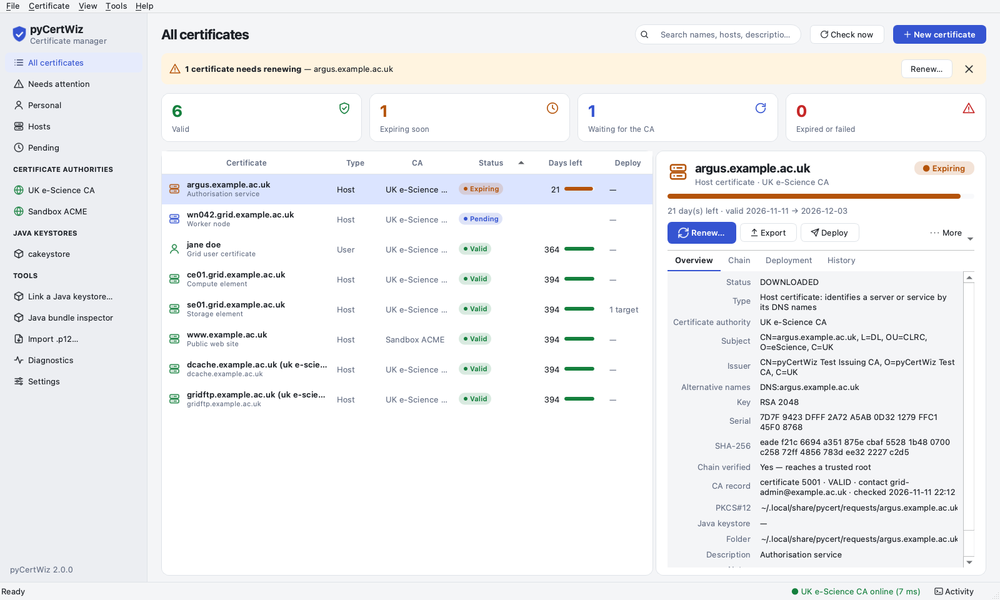
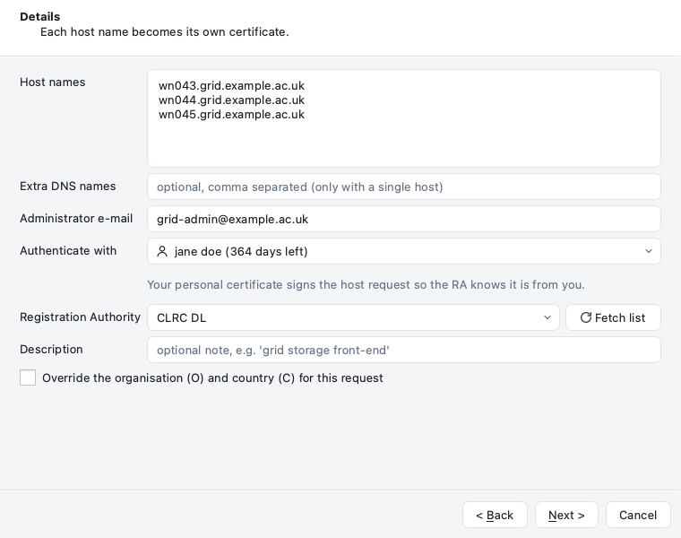
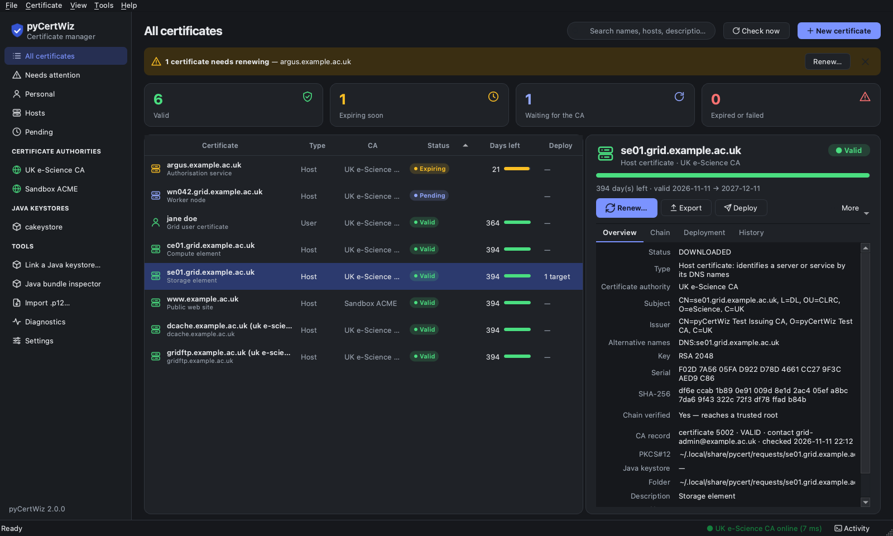

# The desktop application

```console
$ pip install 'pyCertWiz[gui]'      # PySide6 (Qt for Python)
$ pycert gui                     # or: pycert-gui
```

The GUI is a certificate *manager*: one window for every personal and host
certificate you hold, from every configured CA, with their state at the CA,
their expiry, where they are deployed and what to do next.



## Layout

| Area | What it shows |
|---|---|
| **Sidebar** | Views (*All certificates*, *Needs attention*, *Personal*, *Hosts*, *Pending*), one entry per configured CA (the globe turns green when the CA answers, red when it does not), and tools (Java bundle inspector, import, diagnostics, settings). |
| **Header** | Page title, search (names, host names, descriptions, CA), **Check now** (ask the CA about pending requests) and **New certificate**. |
| **Banner** | Appears when certificates need renewing or a CA is unreachable, with a one-click action. |
| **Cards** | Counts of valid, expiring, pending and expired/failed certificates. Click a card to filter. |
| **Table** | One row per certificate: name and description, type, CA (when you have more than one), a colour-coded status pill (never colour alone), expiry date, days left with a lifetime bar, and deployment targets (when any exist). Sort by any column; right-click for actions. |
| **Detail panel** | The selected certificate: status, lifetime remaining, the next sensible action (*Renew…*, *Check for certificate*, *Download & export*), Export, Deploy, Verify and a **More** menu; tabs for **Overview**, **Chain** (leaf → root tree), **Deployment** (targets, last deployment, errors) and **History**. |
| **Status bar** | Primary CA reachability and latency, background activity and the **Activity** log toggle. |

The **Activity** dock (Ctrl/Cmd+L) shows the progress of every background
operation. PINs, passphrases and private keys are never written to it.

## Requesting certificates

**New certificate** opens a wizard:

1. **Certificate authority and type.** Choose the CA, then *Personal* or *Host*.
   Options the CA does not support are disabled (ACME CAs issue host
   certificates only).
2. **Details.** Your name (personal) or **one or many host names** (one per
   line; each becomes its own certificate), contact e-mail, the RA (with *Fetch
   list* from the CA) and the personal certificate that authenticates host
   requests. Optional description and organisation override.
3. **Key and deployment.** RSA or EC with sensible defaults. The wizard warns
   that the UK e-Science CA can only renew RSA certificates in place. Host
   certificates can be deployed automatically (grid-host, nginx and Apache
   layouts; keys are written encrypted). If keystores are linked, choose one
   to store the issued certificate in.
4. **PIN** (CAs with an RA only). Generate a strong PIN (recommended) or type
   your own.
5. **Review** and submit.



Every step is validated with the same rules as the CLI before a key is
generated. After submission the PIN is shown **once** in a dialog with a copy
button. pyCertWiz sends only its hash to the CA and never stores it.

## Waiting, collecting and renewing

You do not need to keep a dialog open while the RA approves a request. The
background monitor (every 30 minutes by default) polls the CA for pending
requests. With *Download and export certificates as soon as the CA issues
them* switched on, it downloads, verifies, exports and deploys new
certificates automatically, then notifies you.

When certificates come within the warning threshold (30 days by default), the
banner and the *Needs attention* view list them. **Renew…** renews one;
**Certificate → Renew everything due…** renews them all, showing the PINs at
the end. A renewal never replaces a working certificate until the new one has
been issued and verified.

**Renew…** first asks the CA for its record of the certificate. If the CA
does not report it as VALID (revoked, unknown, or expired more than 30 days
ago), pyCertWiz says why and stops. Otherwise the dialog fills in the contact
e-mail the CA holds, and warns if you change it, because the renewal replaces
the CA's contact. The *CA record* line in the details shows the CA's status
and contact. **Check now** refreshes it, and the background check fetches it
once for newly imported certificates.

## Deployment

The **Deployment** tab lists the places a certificate is copied to, such as
`/etc/grid-security/hostcert.pem` and `hostkey.pem`, or an nginx `fullchain`
and key. **Add target…** offers the presets or custom paths, file modes,
owner/group and a reload hook. Targets are refreshed whenever the certificate
is issued or renewed, and **Deploy** writes them on demand. Failures are shown
in red and reported by `pycert check`. See [OPERATIONS.md](OPERATIONS.md).

## Other tools

* **Java bundle inspector** opens CertWizard's `cakeystore.pkcs12`, Java
  JKS/JCEKS trust stores and PEM/DER bundles. It lists every certificate with
  its role, details and PEM. **Import all into pyCertWiz** and **Use as
  certificate store…** take a keystore's key entries in one step. It can save all certificates as PEM, write a
  Java-compatible PKCS#12, or update a PKCS#12 in place (with a `.bak`
  backup). Private keys are never displayed.
* **Link a Java keystore…** uses a CertWizard `cakeystore.pkcs12` (or any
  PKCS#12 keystore) as a live store. Its entries appear under **Java
  keystores** in the sidebar, are synchronised when the file changes, and
  receive certificates pyCertWiz issues or renews. Keystore passphrases are
  never stored: pyCertWiz asks for each one at start-up, and **Cancel** leaves it
  locked (padlock icon). Right-click a keystore to unlock, synchronise or
  unlink it. See [KEYSTORES.md](KEYSTORES.md).
* **Export…** (Ctrl/Cmd+E) chooses the format (PKCS#12 by default, PEM
  bundle or files, the key, the certificate, the full chain, DER, PKCS#7), the
  encryption type and whether to include the chain. Anything with a key needs
  a **new passphrase**, entered twice. pyCertWiz's saved passphrase is refused.
  A single key file may have no passphrase, after you type `unencrypted`. See
  [EXPORTING.md](EXPORTING.md).
* **More → View certificate, keys and chain…** (Ctrl/Cmd+K) shows the full
  chain, the public key and, after you type `show`, the private key.
* **More → Rename…** (F2) gives a certificate a clearer name. For a
  certificate in a linked Java keystore it can rename the keystore entry too,
  so CertWizard shows the same name.
* The **Type** column and the *Type* line in the details say whether each
  certificate is a **User** certificate (a person) or a **Host** certificate
  (a server, named by its DNS names). Right-click the column headers to hide
  or show columns.
* **More → Install as ~/.globus…** asks for a new passphrase for
  `userkey.pem`, or none after you type `unencrypted`.
* **Import .p12…** brings an existing certificate and key under management.
* **Diagnostics** runs `pycert doctor` (configuration, chain pins,
  permissions, secret store, deployments, DNS, TLS, clock skew, every CA) and
  shows the results as a table.
* **More → Create proxy certificate…** makes an RFC 3820 proxy for grid jobs.
* **More → Install as ~/.globus…** writes the classic `usercert.pem` /
  `userkey.pem`.

## Settings

**Tools → Settings** (Cmd+, on macOS) edits the configuration file and the
per-user GUI preferences:

* **Identity**: default e-mail, RA and organisation.
* **Keys & export**: default key type and size, `.p12` naming and folder,
  data folder.
* **Certificate authorities**: add ACME CAs (directory URL, contact, terms of
  service, http-01 webroot/standalone or dns-01 hook, EAB key) and other
  CertWizard-protocol CAs; choose the default; remove profiles.
* **Secrets**: the backend that holds the passphrase protecting keys and
  `.p12` files, with a test button.
* **Appearance & monitoring**: system/light/dark appearance, warning and
  critical thresholds, background check interval, automatic collection, the
  menu-bar/tray icon and notifications.

## Appearance

The application uses Qt's Fusion style with a palette tuned for light and dark
mode. *Follow the system* switches live when the OS appearance changes
(Qt 6.5+). **View → Appearance** overrides it.



## Keyboard

| Shortcut | Action |
|---|---|
| Ctrl/Cmd+N | New certificate |
| Ctrl/Cmd+F | Search |
| Ctrl/Cmd+R | Check the selected request at the CA |
| Ctrl/Cmd+E | Export the selected certificate… |
| Ctrl/Cmd+K | View its certificate, keys and chain |
| F2 | Rename it |
| Ctrl/Cmd+I | Import a `.p12` |
| Ctrl/Cmd+B | Java bundle inspector |
| Ctrl/Cmd+L | Activity log |
| Ctrl/Cmd+, | Settings |

## Running remotely and headless

The GUI runs over `ssh -X`, like any Qt application. On servers without a
display, use the CLI. Everything the GUI does is available there, including
`pycert check` for monitoring. Qt's `offscreen` platform
(`QT_QPA_PLATFORM=offscreen`) runs the GUI test suite in CI.

## Why Qt?

PySide6 is the official Qt binding, maintained by The Qt Company. It gives
native-feeling widgets on macOS, Linux and Windows, real dark-mode support,
model/view tables that stay fast with hundreds of certificates, a system tray
and notifications, and HiDPI rendering. It is an optional extra, so the CLI
and library keep `cryptography` as their only runtime dependency.
