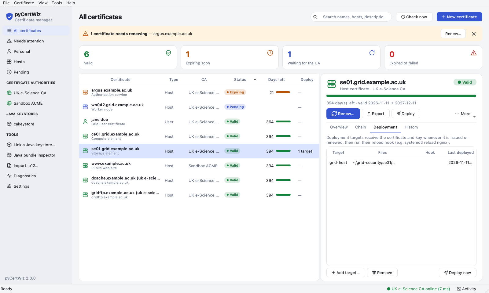

# Operating pyCertWiz for many certificates

This guide is for people who look after more than one certificate: a grid
site with dozens of host certificates, a research group's user certificates,
or web front-ends using a mix of the UK e-Science CA and an ACME CA.

- [Inventory](#inventory)
- [Requesting many host certificates](#requesting-many-host-certificates)
- [Deployment targets](#deployment-targets)
- [Monitoring](#monitoring)
- [Automation](#automation)
- [Running as root for /etc/grid-security](#running-as-root-for-etcgrid-security)

## Inventory

```console
$ pycert list                      # every request, with CA, status and days left
$ pycert list --type host --ca uk-escience
$ pycert report                    # health per certificate (table)
$ pycert report --format csv > certificates.csv
$ pycert report --format json | jq '.[] | select(.days_remaining < 60)'
```

`report` includes the CA, status, health (`OK`/`WARNING`/`CRITICAL`), validity
dates, serial, fingerprint, SANs, key, deployment targets, the auto-renew flag
and your description. Add descriptions with
`pycert edit ALIAS --description "storage front-end"`.

## Requesting many host certificates

Give several host names, or a file with one per line (`#` comments allowed):

```console
$ pycert request web1.example.ac.uk web2.example.ac.uk --type host --auth "jane doe"
$ pycert request --from-file hosts.txt --type host --auth "jane doe" \
      --deploy-preset grid-host --deploy-hook "systemctl reload xrootd"
```

With several names, presets that use fixed file names (`grid-host`,
`globus-user`) deploy each certificate to its own sub-directory (for example
`/etc/grid-security/wn043.example.ac.uk/hostcert.pem`), ready to copy to that
host. Presets that include the name in the file (`nginx`, `apache`) keep one
directory.

Every name is validated before anything is submitted. Each host gets its own
key, CSR, RA PIN and certificate. If one submission fails, the others still
go ahead, and the exit code is 1 with a per-host error.

Host certificates always list their own name as the first DNS SAN, because
TLS clients ignore the CN once a SAN is present. Extra names
(`--san-dns`) are added after it.

## Deployment targets

A deployment target says where a certificate's files go and what to run
afterwards. Targets are stored with the request, applied whenever the
certificate is issued or renewed, and re-applied on demand.

```console
$ pycert deploy presets
grid-host    IGTF grid host layout: /etc/grid-security/hostcert.pem + hostkey.pem
globus-user  Globus/GSI user layout: ~/.globus/usercert.pem + userkey.pem
nginx        nginx: fullchain.pem + privkey.pem (reload nginx afterwards)
apache       Apache httpd: cert, chain and key files (reload httpd afterwards)

$ pycert deploy add web1.example.ac.uk --preset nginx --dir /etc/nginx/ssl --now
$ pycert deploy add web1.example.ac.uk --name backup-p12 --p12 /srv/backup/web1.p12
$ pycert deploy add grid1.example.ac.uk --name grid \
      --cert /etc/grid-security/hostcert.pem --key /etc/grid-security/hostkey.pem \
      --key-mode 0400 --owner root --group root --hook "systemctl reload xrootd"
$ pycert deploy list web1.example.ac.uk
$ pycert deploy run  web1.example.ac.uk            # write files + run hooks now
$ pycert deploy remove web1.example.ac.uk --name backup-p12
```

In the GUI, the **Deployment** tab of a certificate shows the same targets:



File kinds: `cert` (leaf), `key` (private key, PEM), `chain` (issuers),
`fullchain` (leaf + issuers), `bundle` (key + leaf + issuers in one PEM) and
`p12` (a PKCS#12 copy protected with the saved secret).

Safety rules:

* files are written atomically (temporary file, `fsync`, rename) with an
  explicit mode; key files default to `0600`, and anything readable by
  "other" is refused;
* an existing file is kept as `<name>.bak`, and a symlink at a target path is
  refused;
* **private keys are always encrypted** with pyCertWiz's saved passphrase
  (`pycert secret get --show`). Configure the service with it: nginx
  `ssl_password_file`, Apache `SSLPassPhraseDialog exec:`. Bundles (`bundle`,
  `p12`) are always encrypted;
* only a single `key` file can be written *without* a passphrase:
  `pycert deploy add … --key PATH --no-key-passphrase`, or the GUI checkbox.
  You must confirm by typing `unencrypted` (it is refused in non-interactive
  runs). The choice is recorded on the target and applies to every later
  deployment of it;
* the hook runs only after every file of the target is written. It is split
  with `shlex` and run without a shell, with a timeout (`hook_timeout`,
  default 120 s);
* a failed deployment never loses the issued certificate. The error is
  recorded on the target, shown in the GUI and reported by `pycert check`;
* during a renewal the *current* certificate and key stay deployed until the
  new pair has been issued and verified.

## Monitoring

`pycert check` is a monitoring plugin. It prints one line with performance
data and exits `0` OK, `1` WARNING, `2` CRITICAL or `3` UNKNOWN:

```console
$ pycert check --warn 30 --crit 7
PYCERT WARNING - old.example.ac.uk: expires in 21 day(s) | valid=12 expiring=1 expired=0 pending=1 failed=0 drift=0
$ pycert check -v            # plus one line per problem
$ pycert check --json        # everything, for scripts
$ pycert check web1.example.ac.uk --type host --ca uk-escience
```

It reports:

* certificates expiring within `--crit` (CRITICAL) or `--warn` days (WARNING),
  and expired certificates (CRITICAL);
* requests waiting at the CA for more than `--stale-pending` days (default
  14), so a forgotten RA visit is noticed;
* failed requests and failed renewals;
* certificates whose chain was not verified against a trust anchor;
* deployment drift: deployed certificate files that are missing or differ
  from the stored certificate, private-key files with loose permissions, and
  targets whose last deployment failed.

Revoked certificates are listed but never raise the level. Use
`examples/nagios/pycert.cfg` with Nagios, Icinga or NRPE, or the cron line in
`examples/crontab` to e-mail the summary when something needs attention.

`pycert doctor` checks the installation itself: configuration, pins,
permissions, the secret store, deployments, DNS, TLS, clock skew and every
configured CA.

## Automation

| Task | Command | Example |
|---|---|---|
| Collect issued certificates (and deploy them) | `pycert watch --once` | `examples/systemd/pycert-watch.*`, `examples/crontab` |
| Renew ACME certificates | `pycert renew --due 30 --ca letsencrypt --wait --yes` | `examples/systemd/pycert-renew-acme.*` |
| Alert on expiry and drift | `pycert check` | `examples/nagios/pycert.cfg` |

UK e-Science CA renewals involve an RA and a PIN, so they are deliberately
*not* fully automatic. `pycert check` (or the GUI banner) tells you when they
are due, and `pycert renew --due 30` (or **Renew everything due…** in the
GUI) requests them in one go and shows the PINs. Exclude a certificate from
bulk renewal with `pycert edit ALIAS --no-auto-renew`.

## Running as root for /etc/grid-security

Grid host keys usually live in root-owned `/etc/grid-security`. Run pyCertWiz as
root with its own configuration and data directory:

```console
# pycert init /etc/pycert --email grid-ops@example.ac.uk --ra "CLRC DL" --backend file
# PYCERT_CONFIG=/etc/pycert/pycert.toml pycert config set paths.data_dir=/var/lib/pycert
```

* Keep `/etc/pycert` and `/var/lib/pycert` mode `0700`, owned by root.
  `pycert list` audits permissions.
* Choose a secret backend that works without a desktop session: `file` (a
  `0600` file, adequate on a dedicated root-only host), `command` (a site
  vault such as `pass` or HashiCorp Vault) or `env` for systemd credentials.
* Host requests must be authenticated with a personal certificate. Import the
  administrator's certificate into the root store (`pycert import`), or make
  the requests as the administrator and deploy as root with `pycert deploy`.
* Use `--owner`/`--group` on targets when a service runs as a dedicated user
  (for example `--group xrootd --key-mode 0640`).
